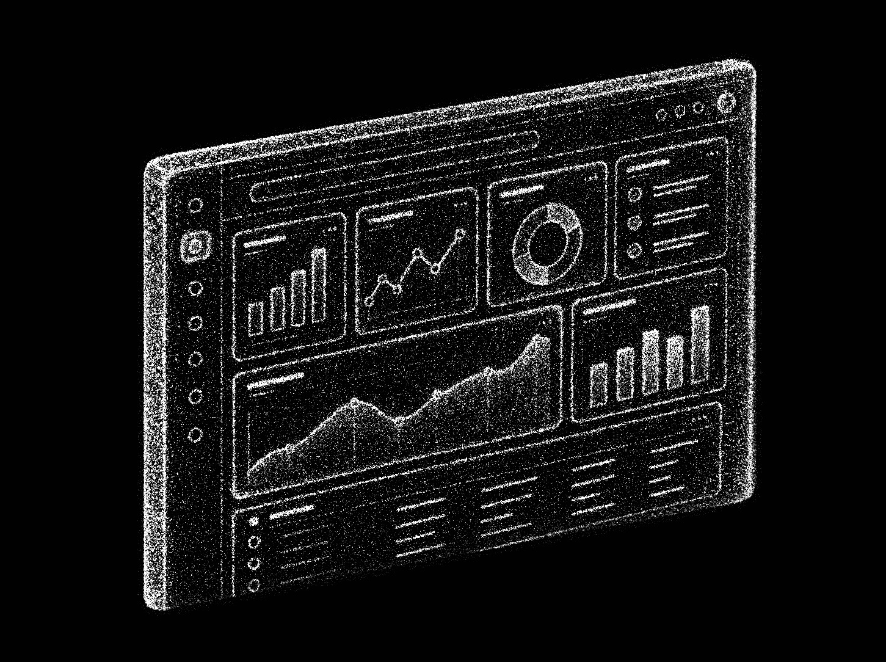
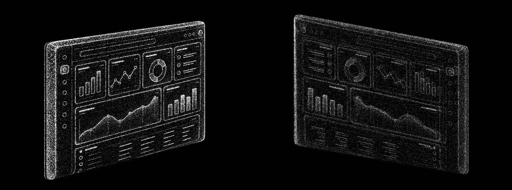

# Dashboard: Three.js dot-particle panel

A Three.js version of `reference.webp`: a tilted analytics dashboard panel built entirely from dots. It uses the same final style as `ev-cycle-particles/v4`. The page uses the reference's 1451 × 1084 artboard, so the front view has the same height, width, angle and layout as the image.

Every change is saved as a new version folder. Older versions stay as they were.

## Versions

| Version | Open | What changed |
| --- | --- | --- |
| **v1** (latest) | `v1/index.html` | First build, in the EV v4 style. A monochrome point cloud: only white and silver-grey dots on pure `#010101`, ultra-small and crisp, with no colour, bloom or glow. The panel is a dense volumetric slab, 100 deep, with softly rounded edges. Its chart cards, bar charts, line and area charts, donut and list rows show through as brighter detail dots on the front face. A soft key light from the upper left shades the dots. The panel turns 360° around its vertical axis, one turn every 14 s. |

## Run

Open a version's `index.html` in a browser. Each one is a single self-contained file. Three.js r160 loads from jsDelivr, so the first load needs a network connection.

| URL flag | Effect |
| --- | --- |
| `?still` | Frozen front view with no intro or turn, for screenshots |
| `?n=150000` | Overrides the dot count (default is 260k on desktop, 120k on touch or small screens) |

`prefers-reduced-motion` turns off the intro and the 360° turn.

## How it's built (v1)

- **Traced geometry, in artboard pixels.** The panel's outline is traced as it appears in the artwork, including its visible left edge and its rounded corners.
- **Depth.** The panel is a slab with its front face at z = 50 and its back face at −50. Its edges round off over a radius of up to 40 px.
- **Dots.** There are four layers:
  - a surface shell on the rounded faces
  - a sparser volume fill through the thickness
  - brighter detail dots on the artwork's highlights (cards, charts, icons, list lines)
  - about 1% stray dots just outside the outline
- **Density.** Dot density follows the artwork's own light and dark closely, so the dark screen stays dark and the charts read.
- **Light and colour.** A soft key light from the upper left, fixed to the camera, shades the dots. The background is `#010101`, and the dots run from silver `#A7ABB0` to white `#F2F2F2`.

## Files

| File | Role |
| --- | --- |
| `v1/index.html` | The scene (one complete file per version) |
| `build_density.py` | Writes `reference.webp`'s luminance into a version page. With no argument it updates the newest `vN/index.html` |
| `reference.webp` | Source artwork (1451 × 1084) |
| `shots/` | Screenshots per version |

## Known limits

- From behind, the screen shows dimmer and mirrored, because dots are visible from both sides.
