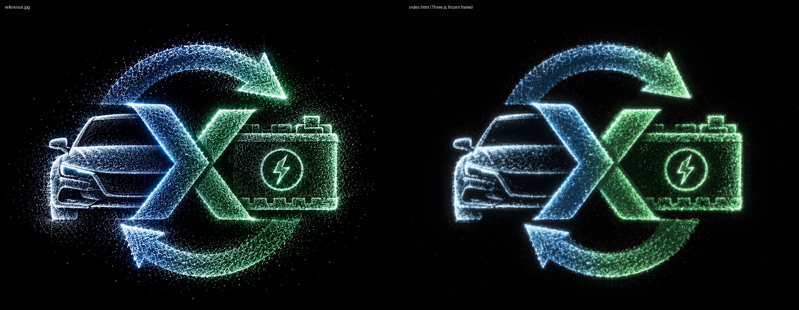

# EV cycle: Three.js dot-particle symbol

A Three.js version of `reference.jpg`: a car and a battery joined by an X inside a two-arrow recycling ring. The whole symbol is built from about 190,000 glowing dots (about 108,000 on phones). The page uses the reference's 2000 × 1494 artboard, so the straight-on view has the same height, width, angle and layout as the image.



## Run

Open `index.html` in a browser. It's one self-contained file. Three.js r160 loads from jsDelivr, so the first load needs a network connection. It also works over any static server:

```sh
npx http-server ev-cycle-particles -p 8765 -c-1
```

| URL flag | Effect |
| --- | --- |
| `?still` | Frozen frame with no intro, for screenshots (`shots/frame-2000x1494.jpg` is a 2000 × 1494 capture) |
| `?debug` | Shows the reference underneath and draws the low-poly wireframe brightly, so you can check alignment |
| `?n=120000` | Overrides the surface dot count (default is 170k on desktop, 90k on touch or small screens) |

## How it's built

- **Traced geometry, in artboard pixels.**
  - The chevrons are traced from their corners.
  - Each arrow edge is a fitted circle (residuals within ±5 px). The tails are cut flat where they meet the X, and the heads are triangles.
  - The battery is boxes plus the badge ring and bolt. The car is a silhouette polygon.
  - `toWorld()` pre-scales x/y by depth, so the front view lands every point on its exact pixel even though the shapes have real depth.
- **Depth.** The blue chevron sits in front, then the green chevron, the battery block and the arrows. The car is a soft dome. Move the pointer and the symbol tilts up to about 9°, which shows the layers and side walls. It eases back to the exact front view when the pointer leaves.
- **Dots.** Particles are importance-sampled from the reference's brightness inside each traced shape, so the car lines, battery detail and texture land where they are in the artwork. There are five layers:
  - a coloured body
  - bright sparkles
  - edge light, snapped to the brightest line next to each traced outline
  - soft glow on the brightest strokes
  - a light dust halo, kept sparse on purpose
- **Colours** come only from the palette: `#010101` background, `#F2F2F2` white, `#07699E` blue, `#339D52` green. Blue fades into green along each arrow, at the points where the reference changes colour.
- **Motion.** Each dot drifts a few pixels around its home point and twinkles slightly. On load the dots gather into the symbol over about 2.8 s. With `prefers-reduced-motion`, the intro is skipped and the drift is cut to a quarter.
- **Low-poly shell.** Each shape also gets a Delaunay-triangulated low-poly mesh: faint facets and lines at 5% opacity, with back edges and walls. They are nearly invisible straight on and hold the silhouette together when the symbol tilts. A depth-only copy hides back edges the way a real solid would.

## Files

| File | Role |
| --- | --- |
| `index.html` | The scene: geometry, particle generator, shaders, low-poly shell, bloom, parallax |
| `build_density.py` | Writes `reference.jpg`'s luminance (WebP, base64) into `index.html`. Re-run it if the reference changes |
| `reference.jpg` | Source artwork (2000 × 1494) |
| `shots/` | Side-by-side comparison and a full-size frame |

## Known limits

- The brand blue `#07699E` is a little greener than the blue in the reference image, so blue areas read slightly more teal than the original. The palette was kept exactly as given.
- The comparison shots were rendered in headless Chromium with software WebGL (SwiftShader). Frame rate on real hardware wasn't measured. It is about 190k points plus bloom, which is light for a desktop GPU. Touch devices get fewer dots and a lower pixel ratio.
