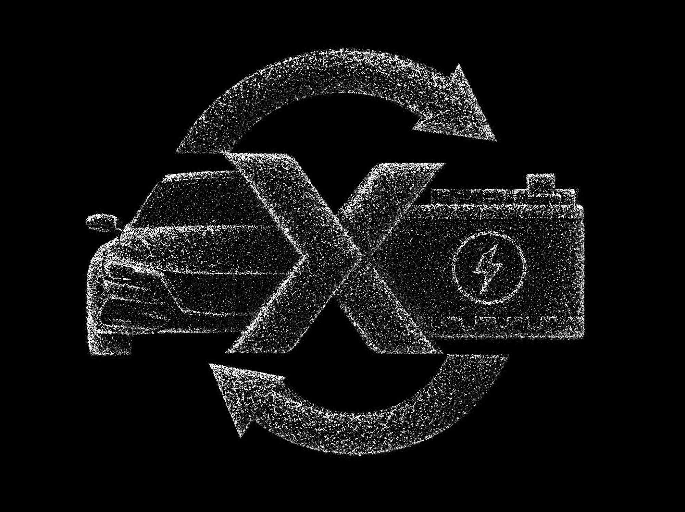
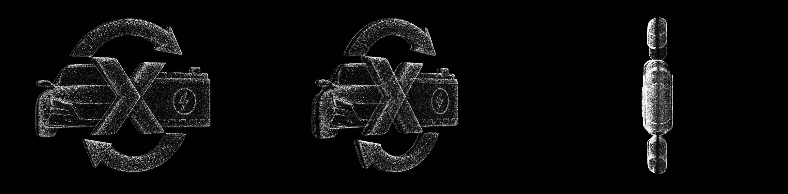

# EV cycle: Three.js dot-particle symbol

A Three.js version of `reference.jpg`: a car and a battery joined by an X inside a two-arrow recycling ring, built entirely from dots. The page uses the reference's 2000 × 1494 artboard, so the front view has the same height, width, angle and layout as the image.

Every change is saved as a new version folder. Older versions stay as they were.

## Versions

| Version | Open | What changed |
| --- | --- | --- |
| **v4** (latest) | `v4/index.html` | Monochrome point cloud. Only white and silver-grey dots on pure `#010101`, ultra-small and crisp, with no colour, bloom, glow or halos. Each part is a dense volumetric cloud with softly rounded edges and a fine, uneven granular surface. A soft key light from the upper left shades the dots, so the 3D depth reads as the cloud turns. Stray dots outside the outlines are kept to about 1%. The outer silhouette, inner cutouts, depth and 360° turn stay as in v3. |
| v3 | `v3/index.html` | Real Z-depth: each part is now a thick solid of dots, 140–200 units deep instead of 30. Each part has a front face, a back face and dotted side walls through the full depth, so the thickness shows as it turns. The badge and bolt stay on the front face. Wall dots fade when seen edge-on, so the front view still matches the artwork. The 360° turn is unchanged. |
| v2 | `v2/index.html` | Only dots now: the low-poly lines, faces and hidden depth mesh from v1 are gone, along with the `?debug` underlay. A continuous 360° turn around the vertical axis (one turn every 14 s) starts from the exact front view once the dots have gathered. The pointer tilt is replaced by the turn. |
| v1 | `v1/index.html` | First build: about 190k dots on the traced symbol, with near-invisible low-poly lines and faces, and pointer tilt. |





## Run

Open a version's `index.html` in a browser. Each one is a single self-contained file. Three.js r160 loads from jsDelivr, so the first load needs a network connection. It also works over any static server:

```sh
npx http-server ev-cycle-particles -p 8765 -c-1
# then open /v4/
```

| URL flag | Effect |
| --- | --- |
| `?still` | Frozen front view with no intro or turn, for screenshots |
| `?n=200000` | Overrides the dot count (v4 default is 380k on desktop, 160k on touch or small screens) |

`prefers-reduced-motion` turns off the intro and the 360° turn, and cuts the dot drift to a quarter.

## How it's built (v4)

- **Traced geometry, in artboard pixels.**
  - The chevrons are traced from their corners.
  - Each arrow edge is a fitted circle (residuals within ±5 px). The tails are cut flat where they meet the X, and the heads are triangles.
  - The battery is boxes plus the badge ring and bolt. The car is a silhouette polygon.
  - `toWorld()` pre-scales x/y by depth, so the front view lands every dot on its exact pixel even though the shapes have real depth.
- **Depth.** Values are [front, back] z, in artboard pixels, centred on the turn axis:

  | Part | Front, back | Thickness |
  | --- | --- | --- |
  | Left chevron (">", in front) | 110, −50 | 160 |
  | Right chevron ("<") | 80, −80 | 160 |
  | Arrows | 70, −70 | 140 |
  | Battery body | 90, −110 | 200 |
  | Battery lid | 70, −90 | 160 |
  | Battery terminal | 40, −60 | 100 |
  | Badge and bolt | raised to 102 on the front | |
  | Car (thickest in the middle) | ±65 at the edges, ±100 in the middle | 130–200 |

- **Rounded volumes.** A distance field from each part's outline eases its thickness to zero over a radius of up to 60 px. This gives every edge a soft, rounded profile instead of a sharp slab wall.
- **Dots.** There are four layers, all tiny crisp points, about 1–2 px on the 2000 px artboard:
  - **Surface shell (58%).** Dots on the rounded front and back faces. More dots go on the curved rim, so the silhouette stays sharp.
  - **Volume (18%).** A sparser fill through the thickness, so each part is a solid cloud and not a hollow shell.
  - **Detail (22%).** Brighter dots where the artwork is brightest: car lines, headlight, badge, bolt and battery rim. These keep the parts recognisable.
  - **Edge strays (1.2%).** A few dots just outside the outlines.
- **Grain.** The artwork's own fine texture breaks up the dot density, so surfaces read uneven and granular. Size, brightness, density and spacing all vary a little.
- **Light.** A soft key light from the upper left, fixed to the camera, shades every surface dot by its rounded surface direction. Faces turned away sit back. This lighting only shades the dots; it adds no surfaces, no glow and no bloom.
- **Colours.** `#010101` background, with dots between silver `#A7ABB0` and white `#F2F2F2`. The output is pure greyscale.
- **Motion.** On load the dots gather into the form over about 2.8 s. Then it turns 360° around its vertical axis, one turn every 14 s. Each dot drifts slightly and twinkles very gently.

## Files

| File | Role |
| --- | --- |
| `v1/` … `v4/` `index.html` | One complete scene per version |
| `build_density.py` | Writes `reference.jpg`'s luminance (WebP, base64) into a version page. With no argument it updates the newest `vN/index.html` |
| `reference.jpg` | Source artwork (2000 × 1494) |
| `shots/` | Screenshots per version (`v1-*` … `v4-*`) |

## Known limits

- v1–v3: the brand blue `#07699E` is a little greener than the blue in the reference image, so blue areas read slightly more teal than the original. The palette was kept exactly as given.
- From behind, the symbol reads as a mirror image of the front, because dots are visible from both sides.
- Screenshots were rendered in headless Chromium with software WebGL (SwiftShader). Frame rate on real hardware wasn't measured. Touch devices get fewer dots and a lower pixel ratio.
