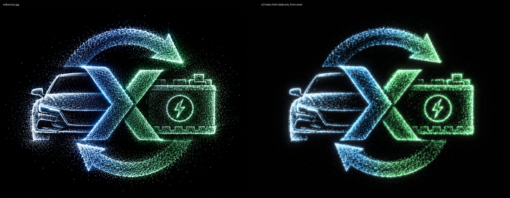
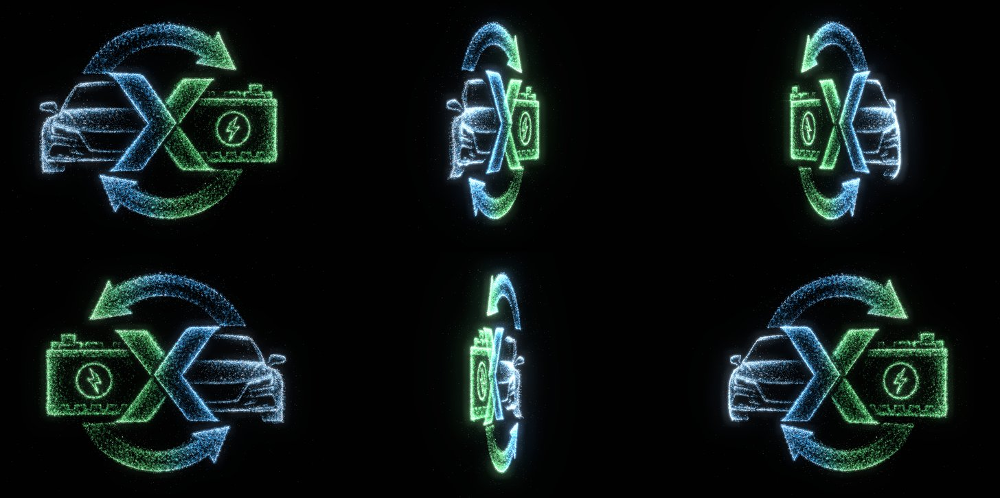

# EV cycle: Three.js dot-particle symbol

A Three.js version of `reference.jpg`: a car and a battery joined by an X inside a two-arrow recycling ring, built from glowing dots. The page uses the reference's 2000 × 1494 artboard, so the front view has the same height, width, angle and layout as the image.

Every change is saved as a new version folder. Older versions stay as they were.

## Versions

| Version | Open | What changed |
| --- | --- | --- |
| **v2** (latest) | `v2/index.html` | Only dots now: the low-poly lines, faces and hidden depth mesh from v1 are gone, along with the `?debug` underlay. A continuous 360° turn around the vertical axis (one turn every 14 s) starts from the exact front view once the dots have gathered. The pointer tilt is replaced by the turn. |
| v1 | `v1/index.html` | First build: about 190k dots on the traced symbol, with near-invisible low-poly lines and faces, and pointer tilt. |





## Run

Open a version's `index.html` in a browser. Each one is a single self-contained file. Three.js r160 loads from jsDelivr, so the first load needs a network connection. It also works over any static server:

```sh
npx http-server ev-cycle-particles -p 8765 -c-1
# then open /v2/
```

| URL flag | Effect |
| --- | --- |
| `?still` | Frozen front view with no intro or turn, for screenshots |
| `?n=120000` | Overrides the surface dot count (default is 170k on desktop, 90k on touch or small screens) |

`prefers-reduced-motion` turns off the intro and the 360° turn, and cuts the dot drift to a quarter.

## How it's built (v2)

- **Traced geometry, in artboard pixels.**
  - The chevrons are traced from their corners.
  - Each arrow edge is a fitted circle (residuals within ±5 px). The tails are cut flat where they meet the X, and the heads are triangles.
  - The battery is boxes plus the badge ring and bolt. The car is a silhouette polygon.
  - `toWorld()` pre-scales x/y by depth, so the front view lands every dot on its exact pixel even though the shapes have real depth.
- **Depth.** The blue chevron sits in front, then the green chevron, the battery block and the arrows. The car is a soft dome. Dots along each outline run through the thickness of each slab, so the symbol keeps its body when it turns side-on.
- **Dots.** Particles are importance-sampled from the reference's brightness inside each traced shape, so the car lines, battery detail and texture land where they are in the artwork. There are six layers, all of them dots:
  - soft base dots
  - coloured body dots
  - bright sparkles
  - edge light, snapped to the brightest line next to each traced outline
  - glow dots on the brightest strokes
  - a light dust halo, kept sparse on purpose
- **Colours** come only from the palette: `#010101` background, `#F2F2F2` white, `#07699E` blue, `#339D52` green.
- **Motion.** On load the dots gather into the symbol over about 2.8 s. The whole symbol then turns 360° around its vertical axis, one turn every 14 s. Each dot also drifts a few pixels and twinkles.

## Files

| File | Role |
| --- | --- |
| `v1/index.html`, `v2/index.html` | One complete scene per version |
| `build_density.py` | Writes `reference.jpg`'s luminance (WebP, base64) into a version page. With no argument it updates the newest `vN/index.html` |
| `reference.jpg` | Source artwork (2000 × 1494) |
| `shots/` | Screenshots per version (`v1-*`, `v2-*`) |

## Known limits

- The brand blue `#07699E` is a little greener than the blue in the reference image, so blue areas read slightly more teal than the original. The palette was kept exactly as given.
- From behind, the symbol reads as a mirror image of the front. Glowing dots are visible from both sides, like a hologram.
- Screenshots were rendered in headless Chromium with software WebGL (SwiftShader). Frame rate on real hardware wasn't measured. Touch devices get fewer dots and a lower pixel ratio.
