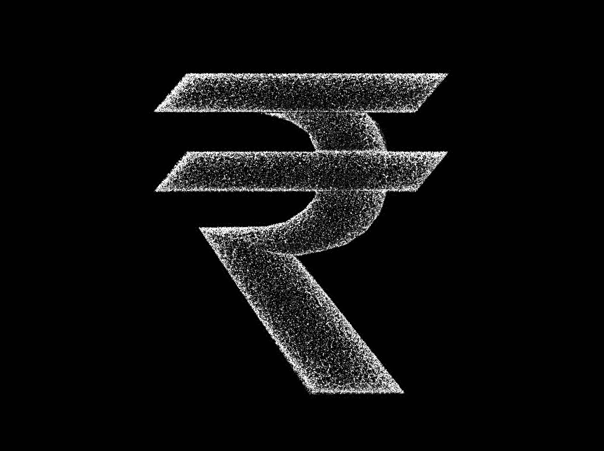
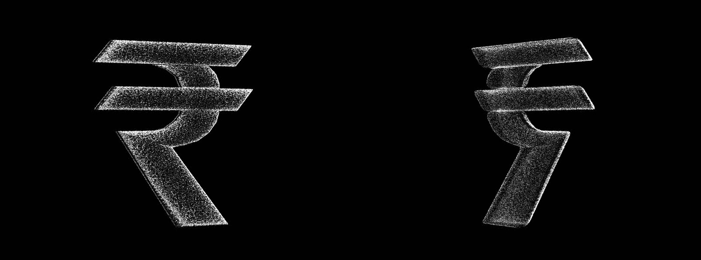

# Rupee: Three.js dot-particle symbol

A Three.js version of `reference.webp`: the Indian rupee sign (₹) built entirely from dots. It uses the same final style as `ev-cycle-particles/v4`. The page uses the reference's 1451 × 1084 artboard, so the front view has the same height, width, angle and layout as the image.

Every change is saved as a new version folder. Older versions stay as they were.

## Versions

| Version | Open | What changed |
| --- | --- | --- |
| **v1** (latest) | `v1/index.html` | First build, in the EV v4 style. A monochrome point cloud: only white and silver-grey dots on pure `#010101`, ultra-small and crisp, with no colour, bloom or glow. The two bars and the bowl-and-leg stroke are dense volumetric clouds with softly rounded edges and real thickness. A soft key light from the upper left shades the dots. The symbol turns 360° around its vertical axis, one turn every 14 s. |

## Run

Open a version's `index.html` in a browser. Each one is a single self-contained file. Three.js r160 loads from jsDelivr, so the first load needs a network connection.

| URL flag | Effect |
| --- | --- |
| `?still` | Frozen front view with no intro or turn, for screenshots |
| `?n=120000` | Overrides the dot count (default is 180k on desktop, 90k on touch or small screens) |

`prefers-reduced-motion` turns off the intro and the 360° turn.

## How it's built (v1)

- **Traced geometry, in artboard pixels.** The ₹ has three parts:
  - the top bar and the middle bar, each a slanted parallelogram
  - the bowl, which curves round between the bars and runs into the diagonal leg
- **Depth.** Values are [front, back] z, in artboard pixels, centred on the turn axis:

  | Part | Front, back | Thickness |
  | --- | --- | --- |
  | Middle bar (crosses in front of the bowl) | 95, −45 | 140 |
  | Top bar | 80, −60 | 140 |
  | Bowl and leg | 60, −80 | 140 |

- **Rounded volumes.** A distance field from each outline eases its thickness to zero over a radius of up to 56 px, so every edge is softly rounded.
- **Dots.** There are four layers:
  - a surface shell on the rounded faces, with extra dots on the curved rim so the silhouette stays crisp
  - a sparser volume fill through the thickness
  - brighter detail dots on the artwork's highlights
  - about 1% stray dots just outside the outlines
- **Grain.** The artwork's own fine texture breaks up the dot density, so the surface reads uneven and granular.
- **Light and colour.** A soft key light from the upper left, fixed to the camera, shades the dots. The background is `#010101`, and the dots run from silver `#A7ABB0` to white `#F2F2F2`.

## Files

| File | Role |
| --- | --- |
| `v1/index.html` | The scene (one complete file per version) |
| `build_density.py` | Writes `reference.webp`'s luminance into a version page. With no argument it updates the newest `vN/index.html` |
| `reference.webp` | Source artwork (1451 × 1084) |
| `shots/` | Screenshots per version |
